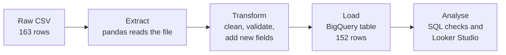
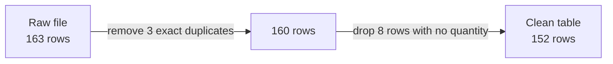
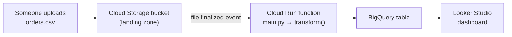
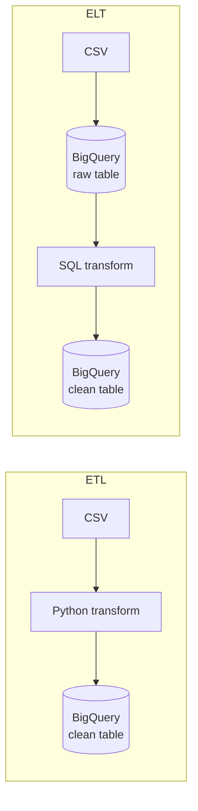
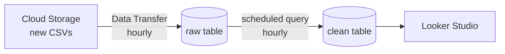

# Phase 8: Cloud ETL Pipeline with Python, BigQuery and Looker Studio

**Advanced Data Analytics · Phase 8 · Weeks 28A and 28B · Portfolio Project 9**

In this project you build a real data pipeline. It takes a messy CSV of supply-chain orders, cleans it with Python, loads the clean data into **Google BigQuery** (a cloud data warehouse) and presents it in a **Looker Studio** dashboard. You then learn how to make the pipeline run on its own (a *live* pipeline), and how to do the same cleaning inside BigQuery with SQL (the *ELT* approach).

Read this README from top to bottom the first time. Every step tells you what to type, what you should see, and what to do if it goes wrong.

---

## Contents

- [What you will build](#what-you-will-build)
- [What you will learn](#what-you-will-learn)
- [Repository layout](#repository-layout)
- [The dataset](#the-dataset)
- [Before you start: accounts and software](#before-you-start-accounts-and-software)
- [Part 1: Set up your computer](#part-1-set-up-your-computer)
- [Part 2: Understand the pipeline](#part-2-understand-the-pipeline)
- [Part 3: Run the ETL pipeline](#part-3-run-the-etl-pipeline)
- [Part 4: Verify the data in BigQuery](#part-4-verify-the-data-in-bigquery)
- [Part 5: Build the Looker Studio dashboard](#part-5-build-the-looker-studio-dashboard)
- [Part 6: Make the pipeline live](#part-6-make-the-pipeline-live)
  - [Option A: Run on a schedule from your computer (free)](#option-a-run-on-a-schedule-from-your-computer-free)
  - [Option B: Run in the cloud when a file arrives (billing account)](#option-b-run-in-the-cloud-when-a-file-arrives-billing-account)
- [Part 7: The ELT approach, cleaning inside BigQuery](#part-7-the-elt-approach-cleaning-inside-bigquery)
- [Part 8: AI executive brief (Portfolio Project 10 preview)](#part-8-ai-executive-brief-portfolio-project-10-preview)
- [Portfolio Project 9: what to submit](#portfolio-project-9-what-to-submit)
- [Troubleshooting](#troubleshooting)
- [Cost, security and good practice](#cost-security-and-good-practice)
- [Glossary](#glossary)
- [For instructors](#for-instructors)

---

## What you will build



By the end you will have:

1. A Python script that turns the raw file into a clean table, using rules you can explain.
2. A clean table in BigQuery: `phase8_training.supply_chain_orders`.
3. SQL queries that prove the load is correct.
4. A Looker Studio dashboard with four required charts.
5. (Optional) The same pipeline running automatically, on a schedule or whenever a new file arrives.

## What you will learn

- What **ETL** (Extract, Transform, Load) and **ELT** (Extract, Load, Transform) mean, and when to use each.
- How to clean data with pandas using **transparent, explainable rules**.
- How to load a DataFrame into BigQuery from Python, and what **write modes** do.
- How to sign in to Google Cloud safely **without key files**.
- How to check a pipeline's output with SQL.
- How to connect Looker Studio to BigQuery.
- How production pipelines are **scheduled** or **triggered by events** in the cloud.

---

## Repository layout

```
.
├── README.md                      ← you are here
├── requirements.txt               ← Python packages for the local pipeline
├── .env.example                   ← template for your settings (copy to .env)
├── .gitignore                     ← stops secrets and clutter being committed
│
├── data/
│   └── supply_chain_orders_raw.csv    ← the raw, intentionally messy dataset
│
├── src/
│   ├── etl_to_bigquery.py         ← Portfolio Project 9: the ETL pipeline
│   └── ai_executive_brief.py      ← Portfolio Project 10: AI reporting assistant
│
├── sql/
│   ├── 01_verify_clean_table.sql      ← checks to run after every load
│   ├── 02_analysis_queries.sql        ← business questions on the clean table
│   ├── 03_elt_transform.sql           ← the ELT version: cleaning in SQL
│   └── 04_time_travel_recovery.sql    ← undo an accidental overwrite
│
├── live_pipeline/
│   ├── local_schedule/
│   │   ├── run_etl.bat            ← Windows Task Scheduler runs this
│   │   └── run_etl.sh             ← macOS / Linux cron runs this
│   └── cloud_function/
│       ├── main.py                ← Cloud Run function (runs on file upload)
│       ├── requirements.txt       ← packages for the cloud function
│       ├── deploy.ps1             ← one-command deploy (Windows)
│       └── deploy.sh              ← one-command deploy (macOS / Linux / Cloud Shell)
│
├── slides/                        ← session slide decks (Weeks 28A, 28B, Phase 8)
└── docs/                          ← Phase 8 instructor and student lab pack
```

---

## The dataset

`data/supply_chain_orders_raw.csv` holds **163 synthetic orders** for food products shipped across four Nigerian regions between **1 August 2026 and 7 January 2027**. It is **synthetic** (made up for teaching) and **deliberately imperfect**, so you have real cleaning decisions to make.

| Column | Meaning | Example |
|---|---|---|
| `order_id` | Unique order reference | `ORD-1001` |
| `order_date` | Date the order was placed (YYYY-MM-DD) | `2026-08-01` |
| `product` | Product ordered (6 products) | `Tomato Paste` |
| `region` | Delivery region (4 regions) | `North West` |
| `supplier` | Supplier name (5 suppliers, some blank) | `Apex Foods` |
| `quantity` | Units ordered (some blank) | `123.0` |
| `unit_cost_ngn` | Cost per unit in Nigerian naira (₦) | `10710.8` |
| `delivery_days` | Days from order to delivery (some impossible values) | `2` |
| `status` | `Delivered`, `Delayed` or `Pending` | `Delivered` |

**Data quality problems hidden in the file** (find them yourself before reading on):

| Problem | How many |
|---|---|
| Exact duplicate rows | 3 |
| Missing `quantity` | 8 |
| Missing `supplier` | 5 |
| Negative `delivery_days` (impossible) | 4 |

---

## Before you start: accounts and software

### Accounts (all free)

| Account | Why | Where |
|---|---|---|
| Google account | Signs you in to BigQuery and Looker Studio | Any Gmail or Google Workspace account |
| Google Cloud project with BigQuery | Holds your dataset and tables | https://console.cloud.google.com/bigquery |
| GitHub account (optional) | To fork this repository and save your own version | https://github.com |

**BigQuery Sandbox:** if you have never used Google Cloud, BigQuery starts you in the **Sandbox**. It is free and needs **no credit card**. Everything in Parts 1 to 5, Part 6 Option A and the first half of Part 7 works in the Sandbox. Sandbox limits to know:
- Tables **expire after 60 days**. Rerun the pipeline to recreate them.
- Scheduled queries, Cloud Storage triggers and Cloud Run functions are **not** available. These need a billing account (Part 6 Option B, Part 7 scheduling).

**Find your project ID:** open the BigQuery console. The project ID is shown in the project picker at the top left, for example `my-training-123456`. It is **not** always the same as the project *name*. You will need the ID many times.

### Software

| Software | Version | Check it with | Install from |
|---|---|---|---|
| Python | 3.10 or newer | `python --version` | https://www.python.org/downloads/ (Windows: tick **"Add python.exe to PATH"**) |
| Git (optional) | any | `git --version` | https://git-scm.com/downloads |
| Google Cloud CLI | latest | `gcloud --version` | https://cloud.google.com/sdk/docs/install |
| VS Code (recommended) | latest | | https://code.visualstudio.com |

> **Cannot install software on your computer?** Use the Google Colab route in [Part 1, Step 8](#step-8-alternative-run-everything-in-google-colab).

---

## Part 1: Set up your computer

Commands are shown for **Windows PowerShell** (the default terminal in VS Code on Windows). Where macOS or Linux differ, the alternative is shown underneath.

### Step 1: Get the code

**With Git:**
```powershell
git clone https://github.com/isichei-nnamdi/phase8-cloud-etl-pipeline.git
cd phase8-cloud-etl-pipeline
```

**Without Git:** on the GitHub page click **Code → Download ZIP**, unzip it, then open the unzipped folder in VS Code (**File → Open Folder**).

From now on, **every command is run from the repository root**, the folder that contains this README. In VS Code, open a terminal with **Terminal → New Terminal**; it starts in the right folder.

### Step 2: Create and activate a virtual environment

A virtual environment keeps this project's packages separate from everything else on your computer.

```powershell
python -m venv .venv
.venv\Scripts\Activate.ps1
```
macOS / Linux:
```bash
python3 -m venv .venv
source .venv/bin/activate
```

You should now see `(.venv)` at the start of your terminal prompt. **Activate it again every time you open a new terminal.**

> **Windows error "running scripts is disabled on this system"?** Run this once, then try again:
> `Set-ExecutionPolicy -Scope CurrentUser RemoteSigned`

### Step 3: Install the Python packages

```powershell
pip install -r requirements.txt
```

This installs pandas, the BigQuery client library, pyarrow (used to send data to BigQuery), python-dotenv (reads your `.env` file) and the OpenAI library (used in Part 8 only).

### Step 4: Install the Google Cloud CLI

1. Download and run the installer from https://cloud.google.com/sdk/docs/install. Keep the default options.
2. **Close VS Code completely** (File → Exit, every window), then open it again.
   This is the step most people miss. VS Code only picks up the new `gcloud` command after a full restart, and a new terminal tab is **not** enough.
3. Check it worked:
   ```powershell
   gcloud --version
   ```

> **Still "gcloud is not recognized"?** Fix the current terminal with:
> `$env:Path += ";$env:LOCALAPPDATA\Google\Cloud SDK\google-cloud-sdk\bin"`

### Step 5: Sign in to Google Cloud

```powershell
gcloud auth application-default login
```

1. A browser window opens. Sign in with the **same Google account** that owns your BigQuery project.
2. If you see a checkbox about **Google Cloud data**, **tick it**. If you leave it unticked, the sign-in looks successful but BigQuery calls fail later.
3. Click **Allow**. The terminal prints `Credentials saved to file: [...]`.

Then attach your project to these credentials. This removes a "quota project" warning you would otherwise see:

```powershell
gcloud auth application-default set-quota-project YOUR_PROJECT_ID
```

**Why this method?** It is called **Application Default Credentials (ADC)**. Python finds your sign-in automatically, so there is **no key file** to download, lose or accidentally publish on GitHub. Older tutorials tell you to download a *service account key* (`.json`) and set `GOOGLE_APPLICATION_CREDENTIALS`. **Do not do that in this course.**

### Step 6: Create your `.env` settings file

The pipeline reads its settings from a file called `.env`. Copy the template:

```powershell
Copy-Item .env.example .env
```
macOS / Linux: `cp .env.example .env`

Open `.env` in VS Code and change **only** `GCP_PROJECT_ID`:

```ini
GCP_PROJECT_ID=my-training-123456
BQ_DATASET=phase8_training
BQ_TABLE=supply_chain_orders
BQ_LOCATION=US
BQ_WRITE_MODE=WRITE_TRUNCATE
```

| Setting | Required? | What it does | Default |
|---|---|---|---|
| `GCP_PROJECT_ID` | **Yes** | Your Google Cloud project ID | none, the script stops without it |
| `BQ_DATASET` | No | The BigQuery dataset (like a folder of tables). Created if it does not exist | `phase8_training` |
| `BQ_TABLE` | No | The table to load into | `supply_chain_orders` |
| `BQ_LOCATION` | No | Where the dataset lives. **Must match** an existing dataset's location | `US` |
| `BQ_WRITE_MODE` | No | `WRITE_TRUNCATE` replaces the table; `WRITE_APPEND` adds rows | `WRITE_TRUNCATE` |
| `SOURCE_FILE` | No | Path to a different input CSV | `data/supply_chain_orders_raw.csv` |

`.env` is listed in `.gitignore`, so it is **never** uploaded to GitHub. Keep it that way.

> **Prefer setting variables in the terminal?** That works too, and terminal values take priority over `.env`:
> PowerShell: `$env:GCP_PROJECT_ID = "my-training-123456"` · macOS / Linux: `export GCP_PROJECT_ID="my-training-123456"`
> These last only until you close that terminal.

### Step 7: Test the connection

```powershell
python -c "from google.cloud import bigquery; print(list(bigquery.Client(project='YOUR_PROJECT_ID').query('SELECT 1 AS ok').result()))"
```

Expected output: `[Row((1,), {'ok': 0})]`. If you see that, setup is complete. If not, see [Troubleshooting](#troubleshooting).

### Step 8 (alternative): Run everything in Google Colab

If you cannot install Python or the Cloud CLI:

1. Go to https://colab.research.google.com and create a new notebook.
2. Upload `data/supply_chain_orders_raw.csv` and `src/etl_to_bigquery.py` using the **Files** panel on the left.
3. Run these cells:
   ```python
   from google.colab import auth
   auth.authenticate_user()          # sign in with your Google account
   ```
   ```python
   import os
   os.environ["GCP_PROJECT_ID"] = "my-training-123456"
   os.environ["SOURCE_FILE"] = "supply_chain_orders_raw.csv"
   ```
   ```python
   !python etl_to_bigquery.py
   ```

---

## Part 2: Understand the pipeline

Open `src/etl_to_bigquery.py`. It has three functions, one per ETL stage:

```python
raw   = extract(SOURCE_FILE)   # E: read the CSV into a pandas DataFrame
clean = transform(raw)         # T: apply the cleaning rules below
load_to_bigquery(clean)        # L: send the DataFrame to BigQuery
```

### The cleaning rules in `transform()`

Every rule is written down so anyone can check it. **You must be able to explain and defend each one.**

| # | Rule | Code | Why |
|---|---|---|---|
| 1 | Make column names lowercase without spaces | `c.strip().lower()` | Consistent names make SQL easier |
| 2 | Convert dates and numbers; bad values become missing | `pd.to_datetime(..., errors="coerce")`, `pd.to_numeric(..., errors="coerce")` | Text like `"abc"` in a number column becomes `NaN` instead of crashing |
| 3 | Remove **exact** duplicate rows | `drop_duplicates()` | The same order recorded twice would double-count its value |
| 4 | Trim spaces and use Title Case in text columns | `.str.strip().str.title()` | `"apex foods "` and `"Apex Foods"` should be one supplier |
| 5 | Drop rows missing a required field | `dropna(subset=[order_id, order_date, product, quantity, unit_cost_ngn])` | You cannot calculate order value without quantity and cost |
| 6 | Keep only positive quantities and non-negative costs | `quantity > 0`, `unit_cost_ngn >= 0` | Impossible values |
| 7 | Negative delivery days become missing (row is kept) | `delivery_days < 0 → NA` | Delivery cannot take negative time, but the rest of the order is valid |
| 8 | Missing supplier becomes `"Unknown"` | `fillna("Unknown")` | Keeps the order's value in totals while showing the gap |
| 9 | **New field:** `order_value_ngn` | `quantity × unit_cost_ngn` | The main business measure |
| 10 | **New field:** `order_month` | `order_date` as `YYYY-MM` | Makes monthly grouping easy |

**Think about it:** rules 5 and 7 treat missing data differently. Rule 5 drops the row; rule 7 keeps the row and blanks one value. Why is that the right choice for each? Would a real business agree?

### Where the rows go



---

## Part 3: Run the ETL pipeline

With your virtual environment active, from the repository root:

```powershell
python src/etl_to_bigquery.py
```

**Expected output:**
```
Raw rows: 163 | Clean rows: 152
Loaded 152 rows into my-training-123456.phase8_training.supply_chain_orders
```

What just happened:
1. The script read the 163-row CSV.
2. It applied the ten rules, leaving 152 rows.
3. It created the dataset `phase8_training` (if it did not exist).
4. It ran a BigQuery **load job** that replaced the table with the 152 clean rows.

### Write modes: replace or add?

| Mode | What happens to the existing table | Use when |
|---|---|---|
| `WRITE_TRUNCATE` (default) | Its rows are **replaced** with the new data | Each file contains **all** orders. Safe to rerun as often as you like |
| `WRITE_APPEND` | New rows are **added** to the end | Each file contains **only new** orders. Running the same file twice loads it twice |
| `WRITE_EMPTY` | Fails if the table has data | You want to be sure nothing is overwritten |

> ⚠️ **`WRITE_TRUNCATE` replaces only the table named in `BQ_TABLE`**, not the whole dataset. But if you point it at a table that holds other data (for example the raw table from Week 28A), that data is replaced. Keep raw and clean data in **different tables**. Overwrote something by mistake? Use `sql/04_time_travel_recovery.sql` within 7 days.

**Rerun the script now.** You get exactly the same 152 rows, not 304. That is what makes a pipeline **repeatable** (or *idempotent*).

---

## Part 4: Verify the data in BigQuery

Never trust a pipeline because it printed "Loaded". Check the data.

1. Open https://console.cloud.google.com/bigquery.
2. In the **Explorer** panel, expand your project → `phase8_training` → `supply_chain_orders`.
3. Click the table and look at the **Schema** tab (column types) and **Preview** tab (first rows).
4. Click **+** (new query tab), paste the queries from `sql/01_verify_clean_table.sql` and click **Run**.

**Expected results** (your numbers must match these):

| Check | Expected |
|---|---|
| Clean rows | **152** |
| Total order value | **₦106,828,531.91** |
| Date range | 2026-08-01 to 2027-01-07 |
| Duplicate order IDs | none |
| Orders by status | Delivered 107 · Delayed 24 · Pending 21 |
| Supplier `Unknown` | 5 |
| Missing `delivery_days` | 3 (the negative values that were blanked) |
| Average `delivery_days` | 3.05 |

If any number differs, something changed in your script or data. Find out what before moving on.

Next, open `sql/02_analysis_queries.sql` and run the business questions: value by region, top products, monthly trend, delays by supplier and more. **Write at least two queries of your own** for your submission.

---

## Part 5: Build the Looker Studio dashboard

1. Open https://lookerstudio.google.com with the same Google account, then click **Create → Report**.
2. Choose the **BigQuery** connector and authorise it the first time.
3. Pick **My projects → your project → `phase8_training` → `supply_chain_orders` → Add**.
4. Fix the field settings (click the data source's edit icon):
   - `order_value_ngn`: type **Currency → NGN (₦)**, aggregation **Sum**
   - `order_date`: type **Date**
   - `delivery_days`: aggregation **Average**
5. Build the required elements:

| Element | Chart type | Dimension | Metric | Expected value |
|---|---|---|---|---|
| Total order value | Scorecard | none | `order_value_ngn` (Sum) | ₦106.8M |
| Order value by region | Bar chart | `region` | `order_value_ngn` (Sum) | South West highest, ₦37.5M |
| Orders by status | Column chart | `status` | Record Count | Delivered 107 |
| Top 5 products | Table | `product` | `order_value_ngn` (Sum), sorted, 5 rows | Tomato Paste ₦26.7M first |
| Date filter | Date range control | `order_date` | | |

6. Label every unit: **₦**, **orders**, **days**. Add a title and a short description of the data source.
7. Click **Share** and give your instructor **Viewer** access.

**Optional fifth element:** a scorecard of average `delivery_days` (3.05 days).

---

## Part 6: Make the pipeline live

So far *you* run the pipeline by hand. In a real company it runs by itself: every night, every hour, or the moment new data arrives. A **live pipeline** needs two things:

1. **New data arriving somewhere**: a new CSV export, an updated file, an API.
2. **Something that runs the pipeline automatically** when that happens.

| | Option A: Scheduled on your computer | Option B: Event-driven in the cloud |
|---|---|---|
| Runs | Every hour or day, on a timer | Seconds after a new file is uploaded |
| Where | Your PC (must be switched on) | Google Cloud (always on) |
| Cost | Free | Needs a billing account (this project's usage normally stays within the free tier) |
| Setup time | 10 minutes | 30 to 45 minutes |
| Good for | Learning, demos, personal projects | Production, teams, portfolio showcase |

Either way, **Looker Studio picks up the new rows on its own** because it reads the BigQuery table directly. To refresh it more often, open the data source and set **Data freshness** to 15 minutes or 1 hour.

### Option A: Run on a schedule from your computer (free)

Your computer runs `live_pipeline/local_schedule/run_etl.bat` (Windows) or `run_etl.sh` (macOS/Linux) on a timer. Each run appends its output to `etl_log.txt` at the repository root.

**Before you start:** Parts 1 to 3 must work, and your `.env` file must be filled in. The scheduled job reads its settings from `.env`.

#### Windows: Task Scheduler

1. Test the batch file by hand first. From the repository root:
   ```powershell
   .\live_pipeline\local_schedule\run_etl.bat
   Get-Content etl_log.txt -Tail 5
   ```
   You should see `Loaded 152 rows into ...` and `exit code 0`.
2. Create an hourly task. Replace the path with the **full path** to your copy of the repository:
   ```powershell
   schtasks /create /tn "Phase8 Supply Chain ETL" /sc hourly /tr "\"C:\path\to\phase8-cloud-etl-pipeline\live_pipeline\local_schedule\run_etl.bat\""
   ```
   - Daily at 7 a.m. instead: `/sc daily /st 07:00`
   - Every 15 minutes: `/sc minute /mo 15`
3. Run it once now to prove it works: `schtasks /run /tn "Phase8 Supply Chain ETL"`, then check `etl_log.txt` again.
4. Manage it later in the **Task Scheduler** app (Start menu → Task Scheduler → Task Scheduler Library).
5. Remove it when you are finished: `schtasks /delete /tn "Phase8 Supply Chain ETL" /f`

> The task runs as you, while you are logged in, so it uses the Google sign-in from Part 1, Step 5.

#### macOS / Linux: cron

```bash
chmod +x live_pipeline/local_schedule/run_etl.sh
./live_pipeline/local_schedule/run_etl.sh && tail -5 etl_log.txt    # test by hand first
crontab -e
```
Add this line to run at the start of every hour (use your full path):
```
0 * * * * /full/path/to/phase8-cloud-etl-pipeline/live_pipeline/local_schedule/run_etl.sh
```

#### See it "live"

1. Open `data/supply_chain_orders_raw.csv` and add a new order at the bottom, for example:
   `ORD-1200,2027-01-08,Rice,South East,Prime Agro,100,15000,3,Pending`
2. Wait for the next run (or trigger it with `schtasks /run ...`).
3. Rerun `sql/01_verify_clean_table.sql`: you now have 153 rows and ₦1,500,000 more order value.
4. Refresh your Looker Studio report.

Remove your test row afterwards so your numbers match the expected results again.

### Option B: Run in the cloud when a file arrives (billing account)

This is how the pipeline runs in production. A **Cloud Storage bucket** acts as a "landing zone". When anyone uploads a CSV to it, Google Cloud automatically starts a **Cloud Run function** that runs the same `transform()` and `load_to_bigquery()` code and updates BigQuery within seconds. Your computer does not need to be on.



> ⚠️ **This option requires a billing account, and your instructor may treat it as optional.** For this project's tiny files, usage normally stays inside Google Cloud's free tier, but Google still requires a payment method on file. **Never** enter card details on a shared or employer account without permission. **Always set a budget alert first** (step B2).

#### B1. Create or link a billing account

1. Go to https://console.cloud.google.com/billing.
2. New to Google Cloud? You may be offered a **free trial** with credit. Follow the sign-up steps.
3. Link the billing account to your project: **Billing → Account management → My projects**, then on your project choose **⋮ → Change billing**.
4. Linking billing takes the project out of the BigQuery Sandbox. Tables you create from now on no longer expire after 60 days.

#### B2. Set a budget alert (do not skip)

1. **Billing → Budgets & alerts → Create budget.**
2. Scope: your project. Amount: a small figure, for example **$5**.
3. Alert thresholds: 50%, 90% and 100%, emailed to you.

A budget **sends warnings; it does not stop spending**. That is why the clean-up step (B6) matters.

#### B3. Deploy with one command

Open `live_pipeline/cloud_function/deploy.ps1` (Windows) or `deploy.sh` (macOS/Linux/Cloud Shell) and edit the values at the top. At minimum, set your project ID:

```powershell
$ProjectId  = "my-training-123456"
$Region     = "us-central1"
```

Then run it from the repository root:

```powershell
powershell -ExecutionPolicy Bypass -File live_pipeline\cloud_function\deploy.ps1
```
macOS / Linux / Cloud Shell:
```bash
bash live_pipeline/cloud_function/deploy.sh
```

The script does five things, printing each step:

| Step | What it does | Why |
|---|---|---|
| 1 | Enables the Cloud Functions, Cloud Run, Cloud Build, Artifact Registry, Eventarc, Pub/Sub, Storage, BigQuery and Logging APIs | Each Google Cloud service must be switched on before first use |
| 2 | Creates the bucket `gs://<project-id>-supply-chain-landing` | The landing zone that new files are uploaded to |
| 3 | Grants permissions to two **service accounts** (robot accounts Google Cloud uses to run your code) | The function needs to read the bucket and write to BigQuery; the bucket needs to send upload events |
| 4 | Copies `src/etl_to_bigquery.py` into the function folder | So the cloud function uses **exactly the same cleaning rules** as your local pipeline |
| 5 | Deploys the function `supply-chain-etl` with a trigger on the bucket | Takes 3 to 5 minutes the first time |

> Prefer to click? Every step can also be done in the console: **Cloud Storage → Create bucket**, then **Cloud Run → Write a function**, with the trigger set to **Cloud Storage, event type `google.cloud.storage.object.v1.finalized`**, runtime **Python 3.12**, entry point **`on_upload`**, and the files from `live_pipeline/cloud_function/` plus `src/etl_to_bigquery.py`. You still need the permissions in step 3.

#### B4. Test it

```powershell
gcloud storage cp data\supply_chain_orders_raw.csv gs://my-training-123456-supply-chain-landing/
```

Wait about 30 seconds, then read the function's logs:

```powershell
gcloud functions logs read supply-chain-etl --gen2 --region=us-central1 --limit=20
```

You should see:
```
New file: gs://my-training-123456-supply-chain-landing/supply_chain_orders_raw.csv
Raw rows: 163 | Clean rows: 152
Loaded 152 rows into my-training-123456.phase8_training.supply_chain_orders
```

You can also watch it in the console: **Cloud Run → supply-chain-etl → Logs**. Then rerun `sql/01_verify_clean_table.sql` in BigQuery.

Now try the "live" test: add a row to a copy of the CSV, upload it, and watch BigQuery and Looker Studio update without running anything yourself.

#### B5. Full refresh or new orders only?

The function is deployed with `BQ_WRITE_MODE=WRITE_TRUNCATE`, so **each uploaded file replaces the table**. That is right when every upload is a full export of all orders.

If instead each upload contains **only new orders** (for example a daily file):
1. Redeploy with `BQ_WRITE_MODE=WRITE_APPEND` (edit it in the deploy script).
2. Protect against the same file being uploaded twice by building your dashboard on a de-duplicated view:
   ```sql
   CREATE OR REPLACE VIEW `phase8_training.supply_chain_orders_latest` AS
   SELECT * EXCEPT(rn) FROM (
     SELECT *, ROW_NUMBER() OVER (PARTITION BY order_id ORDER BY order_date DESC) AS rn
     FROM `phase8_training.supply_chain_orders`
   )
   WHERE rn = 1;
   ```

#### B6. Clean up when you are finished

Delete what you created so nothing keeps running or storing data:

```powershell
gcloud functions delete supply-chain-etl --gen2 --region=us-central1 --quiet
gcloud storage rm --recursive gs://my-training-123456-supply-chain-landing
```

Optionally unlink billing from the project in **Billing → Account management**.

---

## Part 7: The ELT approach, cleaning inside BigQuery

**ETL** (Parts 2 to 6): Python cleans the data *before* it reaches the warehouse.
**ELT**: load the raw data into the warehouse *first*, then clean it with SQL *inside* the warehouse.



| | ETL | ELT |
|---|---|---|
| Where cleaning happens | Python, before loading | SQL, inside BigQuery |
| Raw data kept in the warehouse? | No | Yes, so you can re-clean it later with new rules |
| Scales to huge data? | Limited by your computer's memory | Yes, BigQuery does the work |
| Skills needed | Python and pandas | SQL |
| Common tools | pandas, Airflow, Cloud Run | dbt, Dataform, scheduled queries |

### Step 1: Load the raw CSV unchanged (works in the Sandbox)

1. In the BigQuery console, click **⋮** next to `phase8_training` → **Create table**.
2. **Create table from:** Upload → choose `data/supply_chain_orders_raw.csv`. **File format:** CSV.
3. **Table:** `supply_chain_orders_raw`.
4. **Schema:** tick **Auto detect**.
5. **Advanced options → Header rows to skip:** `1`. Click **Create table**.

Check it: `SELECT COUNT(*) FROM phase8_training.supply_chain_orders_raw` should return **163**.

> Command-line alternative (needs `gcloud auth login` first, a separate sign-in from Part 1):
> `bq load --autodetect --skip_leading_rows=1 --replace --source_format=CSV phase8_training.supply_chain_orders_raw data/supply_chain_orders_raw.csv`

### Step 2: Transform with SQL (works in the Sandbox)

Open `sql/03_elt_transform.sql`, paste it into a query tab and click **Run**. It applies **the same rules** as the Python `transform()` (each rule is commented) and creates `phase8_training.supply_chain_orders_elt`.

The last query in the file checks the result: **152 rows** and **₦106,828,531.91**, the same as the Python pipeline. Compare the two tables yourself:

```sql
SELECT 'etl' AS method, COUNT(*) AS n, ROUND(SUM(order_value_ngn), 2) AS value FROM phase8_training.supply_chain_orders
UNION ALL
SELECT 'elt', COUNT(*), ROUND(SUM(order_value_ngn), 2) FROM phase8_training.supply_chain_orders_elt;
```

### Step 3: Make the ELT pipeline live (billing account)

**Schedule the transformation:**
1. With `03_elt_transform.sql` open in a query tab, click **Schedule → Create new scheduled query**.
2. Name: `rebuild supply_chain_orders_elt`. Repeats: **Hourly** (or Daily).
3. Leave the destination table **empty**: the query's `CREATE OR REPLACE TABLE` already writes the result.
4. Click **Save**. Manage it later under **BigQuery → Scheduled queries**.

**Load new raw files automatically** with the BigQuery Data Transfer Service:
1. **BigQuery → Data transfers → Create transfer**. Source: **Google Cloud Storage**.
2. Destination table: `supply_chain_orders_raw`. Cloud Storage URI: `gs://<your-bucket>/*.csv`.
3. Write preference: **MIRROR** (the table matches the files) or **APPEND** (new files add rows).
4. File format CSV, header rows to skip `1`, schedule hourly.

Together they make a fully managed ELT pipeline with no Python running anywhere:



**Discuss:** which approach would you choose for this business, and why? Think about who maintains the rules (Python or SQL people), how large the data will grow, and whether you need to keep the raw data.

---

## Part 8: AI executive brief (Portfolio Project 10 preview)

`src/ai_executive_brief.py` calculates summary metrics from the data and asks a large language model to draft a short executive brief.

1. Add your API key and a model name your account can use to `.env`:
   ```ini
   OPENAI_API_KEY=sk-...
   OPENAI_MODEL=<a model available to your account>
   ```
2. Run: `python src/ai_executive_brief.py`. The brief is printed and saved to `executive_brief.md`.

**Important:** this is a proof of concept. Check every number and claim in the brief against your SQL results before sharing it. AI models can state wrong figures confidently. Never commit your API key. This script is used in Week 29.

---

## Portfolio Project 9: what to submit

**Weight: 50% of Phase 8.** You must be able to explain your own code and defend every cleaning decision.

| Deliverable | What it must contain |
|---|---|
| Raw CSV and cleaning script | **Your own edited** script or notebook, not the unchanged starter |
| BigQuery table and SQL | The loaded table plus your verification and analysis queries |
| Looker Studio dashboard | The four required elements, units labelled, shared as Viewer |
| Data dictionary | Every column of the clean table, its type, and one sentence per cleaning rule |
| Evidence | Screenshots of the load output, query results and dashboard |
| Reflection | One limitation, one cost or security point, one improvement |

| Marking area | Marks |
|---|---|
| Extraction | 10 |
| Cleaning and validation | 15 |
| BigQuery load and query | 15 |
| Dashboard | 5 |
| Documentation | 5 |

**Data dictionary template:**

| Column | Type in BigQuery | Description | Cleaning rule applied |
|---|---|---|---|
| `order_id` | | | |
| ... | | | |

**Stretch goals for a stronger portfolio:**
- Add `assert` checks at the end of `transform()` (no duplicate IDs, no negative quantities, row count above zero) so the pipeline stops if the data is wrong.
- Make the pipeline live with Option A or B, and include the log or Cloud Run screenshot as evidence.
- Build the ELT version and compare it with your ETL output.
- Fork this repository and publish your own version on GitHub, without your `.env` file.

---

## Troubleshooting

Read the **last line** of a Python error first: it names the problem.

| What you see | Likely cause | Fix |
|---|---|---|
| `gcloud : The term 'gcloud' is not recognized` | VS Code was open while you installed the CLI | Fully quit and reopen VS Code (Part 1, Step 4) |
| `python` opens the Microsoft Store, or is not recognized | Python not installed, or not on PATH | Reinstall Python and tick **Add python.exe to PATH** |
| `running scripts is disabled on this system` | PowerShell blocks the activate script | `Set-ExecutionPolicy -Scope CurrentUser RemoteSigned` |
| `ModuleNotFoundError: No module named 'pandas'` (or `pyarrow`, `google`) | Virtual environment not active, or packages not installed | Activate `.venv`, then `pip install -r requirements.txt` |
| `KeyError: 'GCP_PROJECT_ID'` | No `.env` file, or the variable is not set | Create `.env` from `.env.example` (Part 1, Step 6) |
| `DefaultCredentialsError` | Not signed in to Google Cloud | `gcloud auth application-default login` |
| `UserWarning: ... without a quota project` | Credentials have no project attached | `gcloud auth application-default set-quota-project YOUR_PROJECT_ID` (only a warning, the load still works) |
| `403 Access Denied` / `does not have bigquery.jobs.create permission` | Wrong project ID, or signed in with a different Google account | Check `GCP_PROJECT_ID` against the console, and sign in again with the right account |
| `Dataset ... was not found in location US` | Your dataset exists in another location | Set `BQ_LOCATION` in `.env` to the dataset's location (shown in its **Details** tab) |
| `FileNotFoundError: ...supply_chain_orders_raw.csv` | The CSV was moved or renamed | Keep it in `data/`, or set `SOURCE_FILE` in `.env` |
| My table now has the wrong data | `WRITE_TRUNCATE` replaced it | Recover it with `sql/04_time_travel_recovery.sql` within 7 days |
| My table has disappeared | Sandbox tables expire after 60 days | Rerun `python src/etl_to_bigquery.py` |
| Dashboard total looks wrong | Field aggregation set to Count or Average | Set `order_value_ngn` to **Sum** |
| `Billing has not been enabled` | That feature needs a billing account | Use the Sandbox-friendly options, or follow Part 6 B1 |
| Deploy fails at **Build** with a permission error | The Cloud Build service account lacks a role | Rerun the deploy script (it grants the roles), wait 2 minutes, try again |
| Deploy fails mentioning **Eventarc** or **Pub/Sub** service agent | Permissions on a brand-new project take a few minutes to apply | Wait 5 minutes and rerun the deploy script |
| Function deployed but nothing happens on upload | File not ending in `.csv`, or uploaded to a different bucket | Check the logs (Part 6 B4) and the bucket name |
| Scheduled task runs but `etl_log.txt` shows an error | `.env` missing, or `.venv` not created in the repo root | Run `run_etl.bat` by hand and read the error |

Still stuck? Copy the **full** error message, the command you ran and what you expected into the class channel.

---

## Cost, security and good practice

- **Never commit secrets.** `.env`, API keys and service-account `.json` files must never go into Git. `.gitignore` blocks the common ones. Check `git status` before every commit.
- **No key files.** Use `gcloud auth application-default login` locally and the built-in service account in the cloud.
- **Least privilege.** The cloud function's account gets only the roles it needs (BigQuery data editor and job user, Storage object viewer, event receiver).
- **Budgets.** Any project with billing should have a budget alert. Delete cloud resources you are not using.
- **Query cost.** BigQuery charges for the data a query **scans**. Select only the columns you need instead of `SELECT *` on large tables, and check the estimate at the top right of the query editor before running it.
- **Repeatability.** A good pipeline gives the same result every time it runs on the same input, logs what it did, and fails loudly when the data is wrong.

Check current prices on Google Cloud's pricing pages before running paid services; free tiers and prices change.

---

## Glossary

| Term | Meaning |
|---|---|
| **ETL** | Extract, Transform, Load: clean data before it enters the warehouse |
| **ELT** | Extract, Load, Transform: load raw data first, clean it inside the warehouse with SQL |
| **BigQuery** | Google's serverless cloud data warehouse, queried with SQL |
| **Project / dataset / table** | BigQuery's hierarchy: a project contains datasets, a dataset contains tables. Full name: `project.dataset.table` |
| **Sandbox** | Free BigQuery mode without a billing account, with some limits |
| **Load job** | A BigQuery operation that imports data into a table |
| **Write disposition** | What a load job does to existing data: truncate (replace), append (add) or empty (fail if data exists) |
| **Idempotent** | Running it twice gives the same result as running it once |
| **ADC** | Application Default Credentials: how Google libraries find your sign-in automatically |
| **Service account** | A non-human Google Cloud identity that runs code |
| **Cloud Storage bucket** | A cloud folder for files, addressed as `gs://bucket-name/` |
| **Cloud Run function** | Code that Google Cloud runs for you when an event happens |
| **Event trigger** | A rule that starts a function, such as "a file was uploaded to this bucket" |
| **Scheduled query** | A BigQuery SQL query that runs automatically on a timetable |
| **Time travel** | BigQuery's ability to query a table as it was at an earlier time (up to 7 days) |
| **Virtual environment** | A folder (`.venv`) holding the Python packages for one project |

---

## For instructors

- **Slides** are in `slides/`. Week 28A covers cloud concepts and SQL on the raw table; Week 28B covers this pipeline, with speaker notes on every slide. The Week 28B deck includes the **challenge solution**, so share a version without it before the session if you use the challenge.
- **Lab pack** (activities, prompts, rubric and guardrails) is in `docs/`.
- **Expected numbers** for every check are in Part 4. Any learner reporting something other than 163 → 152 rows and ₦106,828,531.91 has a problem worth following up.
- **Before each cohort:** run Parts 1 to 4 yourself from a fresh clone and a fresh virtual environment, and check that package versions and Google Cloud console screens still match this README.
- **Dates in the dataset** run to January 2027. If that looks odd for a later cohort, explain that the data is synthetic, or shift the dates.
- Part 6 Option B and Part 7 Step 3 need billing. Treat them as **optional or as an instructor demo** unless your institution provides billing-enabled projects.

---

*The dataset is synthetic and created for teaching. Review the starter scripts and adapt them before classroom use.*
